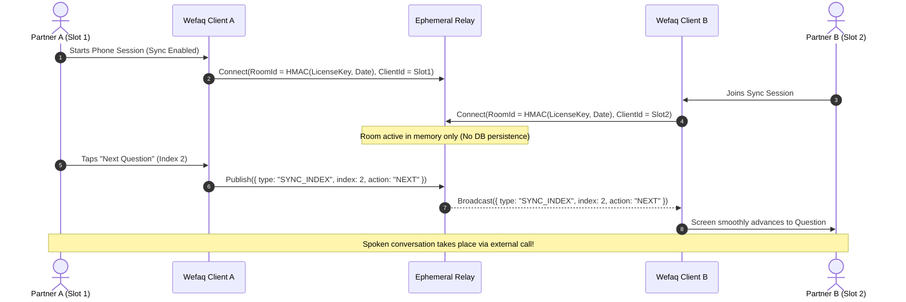

# ADR 0006: Lightweight Zero-Knowledge Live Session Synchronization

**Status:** Proposed / Architecture Baseline  
**Date:** 12 November 2026  
**Deciders:** Core Engineering, Security & Privacy Architecture  
**Consulted:** Product Owner, Mobile Team

---

## 1. Context and Problem Statement

In phases P1 through P5, Wefaq supported two primary usage modes:
1. **Together Mode:** Both partners sit together and read/interact using a single shared screen.
2. **Phone Mode:** Partners speak over an external phone call (cellular, WhatsApp, FaceTime), while one partner reads the questions aloud from their device.

While effective, user feedback from engaged couples in different cities indicates a strong desire for **simultaneous reading and synchronized card flipping** during phone calls (e.g. when Partner A flips to the next question, Partner B's screen automatically transitions to that same question).

However, live synchronization introduces significant privacy risks if not architected with extreme discipline.

### Non-Negotiable Privacy Invariant
- **ZERO storage or transmission of dialogue content:** Wefaq must never transmit, record, transcribe, or store speech, verbal answers, user notes, or emotional reactions.
- **Minimal attack surface:** Session signaling must carry only opaque navigation indices.

---

## 2. Decision: Ephemeral Zero-Knowledge Relay

We adopt an **ephemeral, stateless signaling relay** utilizing license-derived room tokens:



---

## 3. Detailed Architectural Principles

### 1. Minimal Signaling Payload
Signaling packets are strictly limited to structural navigational events:
```json
{
  "type": "NAVIGATE",
  "sessionId": "ses_019348...",
  "questionIndex": 3,
  "action": "advance",
  "isSkipped": false,
  "timestamp": 1794508800000
}
```
**Strictly Prohibited:** Any packet containing voice, text responses, microphone status, or user notes.

### 2. Ephemeral In-Memory State
- The relay server maintains active connections in volatile memory only.
- When both devices disconnect or after 2 hours of inactivity, the ephemeral room is garbage-collected.
- Zero databases, zero audit logs containing question selections, and zero packet inspection.

### 3. Asymmetric Security & Authorization
- Room access requires mutual proof of possessing an authorized slot under an active, verified license (Slot 1 or Slot 2).
- Third parties attempting to connect without valid license authorization are dropped at the TLS handshake level.

### 4. Resilient Fallback to Autonomous Local Control
- If internet connectivity drops on either device or the relay becomes unreachable:
  - The client displays an unobtrusive status pill: `"الاتصال متوقف مؤقتًا — يمكنك متابعة القراءة محليًا"` (Connection paused — you can continue reading locally).
  - The local session continues seamlessly without freezing or losing progress.
  - When connection re-establishes, the latest index reconciles gracefully without overwriting local favorites.

---

## 4. Consequences and Trade-offs

### Positive
- **Enhanced Couple Intimacy:** Both partners see the same question typography, clarifications, and progress simultaneously during external calls.
- **Uncompromised Privacy:** 100% compliant with Law 151/2020 and Wefaq's zero-knowledge baseline.
- **Lightweight Infrastructure:** A simple stateless Go or Dart shelf WebSocket relay can handle tens of thousands of concurrent synchronized sessions with negligible memory and CPU overhead.

### Negative
- **Network Dependency:** Synchronized mode requires data connectivity on both devices (whereas single-device phone mode functions entirely offline).
- **Packet Jitter:** Cellular latency variations may cause a 100–300ms transition delay between screens.
