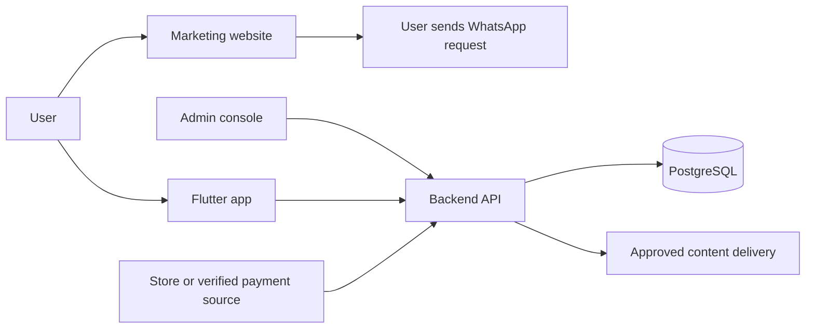

# Wefaq production plan and agent handoff

**Planning baseline: 12 November 2026.** This is a roadmap, not proof of implementation, legal compliance, religious approval, or store approval. Source code and applicable project instructions take precedence over stale descriptions. Recheck facts and update this document when decisions change.

**Owner update, 13 November 2026:** For the current offline release, all available features are open without activation, paid plans, quotas, or a backend. Previous licensing and payment sections below are deferred future concepts, not current scope or completed capabilities. The existing experimental licensing code must remain disconnected from the user journey. This does not waive content review, persistence, legal, accessibility, or release checks.

## 1. Product mission and boundaries

Wefaq (وفاق) helps engaged adults start respectful, useful conversations using clear questions and lightweight activities. The intended system includes an Arabic RTL Flutter app, marketing website, content administration, and a secure entitlement system. The first market is assumed to be Egypt, using Egyptian-friendly Arabic and an adult audience of 18+; the product owner and counsel must confirm these assumptions before release.

The product facilitates discussion. It is not a matchmaking service, chat or call provider, compatibility diagnosis, fatwa service, therapy, or guarantee of marriage success. Never pressure either person to answer. In phone mode, one person reads questions during an **external** call; live synchronization is a later feature. Do not collect answer text or audio by default.

### Owner requirements

- Together mode on one device and phone mode; configure topic, level and number of questions; show available counts and do not repeat within a session.
- Diverse reviewed questions across life domains, eventually targeting 2,000. Quality and review are release gates; the quantity is a goal, not evidence of quality.
- Respectful activities after the core flow is verified.
- Website explains benefits, price, subscription and support.
- Explore a manual commercial flow where compatible with the channel: WhatsApp request, confirmed payment, device IDs, and code activation.
- Admin can configure a start/end date, duration and/or session quota, and bind a license to one or two specified installations. One code may activate the two authorized installations. Shared quota is a proposed default, pending a business decision.
- Protect privacy, follow agreed religious content constraints, and obtain legal and store-policy review before production.

**Not in first release:** built-in calling, chat, recordings, remote storage of answers, matching, compatibility scoring, automated religious rulings, user-generated public content, or live multiplayer. Each requires separate product, privacy and safety review.

## 2. Verified repository baseline

At this plan's creation, the working branch is `codex/session-flow`, commit `349f538`. The remote default branch was `codex/start` and did not include all session work. Recheck the remote and current branch before changing anything. Do not assume a merge or create a PR without authorization.

| Area | Current code | Gaps / Status |
|---|---|---|
| App | Flutter Android/iOS, Arabic RTL, Cairo, centralized theme tokens (`AppColors`, `AppSpacing`), responsive components (`ResponsiveContainer`, `WefaqCard`, `NoticeBanner`) | P1 foundation delivered; accessible at 320px & 1.5x scaling |
| Session | Together/phone, topic/depth chips, mixed topics, count bounds, next/previous/skip/summary, atomic session persistence (`FileSessionStorage`), resumption on HomeScreen | P2 session persistence and resumption implemented (ADR 0001) |
| Content | Versioned JSON repository (`assets/content/questions_v1.json`, `JsonAssetQuestionRepository`) with fallback to prototypes | 12 prototype questions marked `isDevelopmentOnly: true`; review workflow defined |
| Favorites & Anti-repetition | Local favorites (`FileFavoritesStorage`), anti-repetition sliding window (`QuestionHistoryStorage`) | Implemented (ADR 0003); zero answer capture |
| Activities | Discussion scenarios & mutual priority ordering (`ActivityCard`, `ActivitiesScreen`) | Implemented (ADR 0004); zero data collection |
| Privacy | Strict privacy: zero capture of answers, text notes, rankings, or audio; local atomic files | ADR 0001 & ADR 0003 enforced |
| Licensing | Threat model and architecture defined (Keystore Ed25519, 2-device caps, idempotency) | ADR 0002 approved; implementation in P3 |
| Verification | 67 tests passing across 8 suites; 0 analyze issues; tested on physical Redmi Note 8 Pro (v0.1.0+5) | Continuous regression verification |

`SessionProgress` is in memory only: exiting or killing the app loses progress, as the UI states. Do not silently change this contract; define persistence, migration and messaging first. Randomization currently guarantees neither avoidance of repeats between sessions nor reviewed content. The package ID `com.wefaq.wefaq` and raster launcher artwork are placeholders until ownership and release decisions are complete.

### First steps for every agent

1. Read applicable `AGENTS.md`/`CLAUDE.md`, README, CI, `pubspec.yaml`, relevant code/tests and recent commits. Project instructions override this plan. Inspect `git status`; preserve unrelated user work.
2. Fetch and inspect the intended base when possible. Work on a non-default `codex/` branch. Do not commit, push, merge, publish or deploy without authorization.
3. Trace callers, state ownership, persisted formats, lifecycle, platform and failure paths before editing. Separate proposed features from implemented ones.
4. Follow existing Flutter structure, shared theme and components; separate UI from selection, entitlement and data logic. Extract shared design tokens and localized strings as the project grows.
5. Run applicable checks, review architecture, security, regressions and actual user-facing flows, and report commands, results and unavailable checks. Never add secrets or personal data to logs or the repository.
6. Decisions marked **open** belong to the owner or qualified reviewer; agents must not invent approval. Work independently on reversible, unblocked tasks.

## 3. Decisions and gates

| Decision | Proposed default | Status / owner |
|---|---|---|
| Market and age | Egypt, 18+ | Assumption; owner and counsel |
| Platform order | Android, then iOS | Proposal; owner confirms |
| Distribution | App stores or direct Android delivery | **Open; blocks payment architecture**; owner and policy review |
| Plans | Duration, quota, or both; one/two devices | Desired; price, terms and SKUs open |
| Start date | Configurable fixed date or first successful activation | Proposal; specify timezone, expiry and redemption deadline |
| Quota | One new session, shared across authorized devices | Proposal; define accounting contract |
| Offline | Short bounded lease for time access; quota session creation online | Proposal; owner decides tradeoffs |
| Backend | Modular backend and PostgreSQL | Recommendation; stack and hosting open |
| Website | SEO-friendly web stack; not necessarily Flutter Web | Open; compare accessibility, performance and team skills |
| Content | Named qualified religious and family reviewers; written standard | Mandatory before publication; reviewers and standard open |
| Device binding | Installation key and server-authorized slots | Proposal; recovery and replacement policy open |
| Resume and favorites | Private local storage without answers | Proposal; retention and recovery open |
| Legal and payments | Counsel, accountant and provider review | Required before commercial launch |

Do not invent endorsements, reviewers, prices, refund rights, payment-provider permissions or compliance claims. An unresolved decision blocks dependent behavior, not independent groundwork.

## 4. User journeys and acceptance

### First use and home

Explain purpose, age/eligibility if adopted, privacy summary and terms. Offer an honest free experience if chosen. Do not collect name, photos, contacts, location or answers without a documented purpose. Arabic RTL, screen reader labels, text scaling and touch targets must work. No placeholder controls may imply an unavailable feature exists.

### Session setup and dialogue

Choose mode, category or mix, depth and count from eligible published content. One question per card; previous, skip, next, cancel and complete. No forced answer or timer. If fewer questions exist than requested, show the actual number and let the user change selections. The summary distinguishes skipped from advanced questions and does not claim to know what was discussed. Clear sensitive-topic notices and a right to skip are required.

**Acceptance:** mode, topic, level and available count work; zero/insufficient results, navigation, skip/revisit, completion, interruption and cancellation have explicit outcomes. No answer is captured. Small screens, large text, RTL and screen readers remain usable. Phone mode must not suggest the app places or synchronizes a call.

### Resume, favorites and activities

Proposed: persist question IDs/order, mode, index and skip markers locally, never answer text/audio. Define retention, deletion, explicit end versus background/process death, device loss and content withdrawal. Favorites remain local unless a separately reviewed recovery mechanism exists; explain uninstall/device-loss effects. A critical content withdrawal must be handled for active and cached sessions, including offline policy.

Candidate activities: choose a topic, discuss a scenario, sort priorities. Each requires independent religious/family review and skip/stop behavior. No forced disclosure, personal images, dares or compatibility scores. Activities are not a release prerequisite unless the owner decides otherwise.

### Purchase, activation and support

Before payment, display price/currency, entitlement, duration, activation deadline, session accounting, device cap, support times and reviewed cancellation/refund terms. Website can prepare a WhatsApp message; the user must press **Send**. A screenshot of payment alone is not proof of settlement. Staff verify through a reliable source. Never request an OTP, payment password or full card number.

Create a random installation ID and an installation-specific key; do not use IMEI, advertising ID or claim a permanent hardware fingerprint. An operator authorizes one or two installation identities for one license. One customer-facing code can redeem for those devices only; each receives its own proof/lease. Distinguish expired, revoked, exhausted, wrong-device and network failure safely. Replacement needs a published recovery procedure, identity verification, slot revocation, limits, audit and offline implications. Reinstall can create a new installation.

**Acceptance:** wrong/third installation rejected; simultaneous claims cannot exceed cap; retries are idempotent; owner can replace/recover under published terms; support is reachable. No codes or device IDs in logs or analytics.

## 5. Content production and review

Target 300–500 reviewed questions for a pilot, then expand toward 2,000 subject to funding, reviewer capacity and feedback. Potential areas: values, communication, conflict, family boundaries, marriage expectations, finances, work, home, children and parenting, health and habits, privacy and social relationships, decisions, interests and scenarios. Select sensitive subjects with qualified reviewers.

Lifecycle: **draft → duplicate/editorial check → family/sensitivity review → religious review against a written standard → approval → publication → retirement/withdrawal**. Keep version, review decision, reviewer, standard version, timestamp, authorship, rights and reason. Editing approved content creates a new draft requiring renewed review. Client receives only published approved versions. Provide a withdrawal mechanism and define offline behavior. AI may propose drafts; humans review every published question and activity.

Suggested fields: stable opaque ID, language, text, optional clarification, topic/tags, depth, mode suitability, sensitivity, review status, content version and publication/withdrawal timestamps. Questions must be clear, neutral, non-coercive and appropriate to engagement; do not request unnecessary intimate details or imply a religious ruling. Allow skipping and reporting; keep optional report text and retention transparent.

## 6. Proposed architecture



This diagram describes proposed infrastructure, not existing services. Choose backend framework, deployment, hosting geography, identity provider and web stack in ADRs. Start with a modular monolith; introduce queues/services only for demonstrated need. Isolate production, staging and test data and credentials. Use HTTPS with normal certificate validation and server-side authorization.

**Flutter boundaries:** presentation owns screens/navigation; domain owns selection, session lifecycle and entitlement rules; data owns repositories, local storage, secure keys, migrations and API communication. The server is authoritative for entitlements, quota, time and publication. Client checks are convenience and bounded cached leases, not sole enforcement. Keep logic out of widgets.

Device-generated asymmetric keys belong in platform secure storage when available; register only the public key and verify challenges with well-reviewed libraries. Never embed administrative secrets or private signing keys. Secure storage can fail or reset; design recovery. Attestation is optional defense in depth, not an unbreakable guarantee.

### Server model and invariants

- `Question`, `QuestionVersion`, `Review`, `ContentRelease`: stable IDs, immutable review history, versioned publication and withdrawal.
- `Plan`: revisioned SKU, channel, entitlement, duration/quota and device cap. Snapshot terms when issuing a license; later plan edits cannot silently alter old terms.
- `Order`, `PaymentEvidence`: order/payment states and minimum verification reference; no OTP or card secrets. Payment and license states are separate.
- `License`: status, plan snapshot, UTC start/end, total/remaining quota or ledger and revocation reason. Preserve required accounting history.
- `Installation` and `LicenseInstallation`: random ID, public key and status; permitted slots with database uniqueness and transactional cap enforcement. Retain/link only with documented basis.
- `ActivationCode`: high-entropy code, stored as keyed hash, expiry, associated license and authorized slots; do not log plaintext. One code can activate two preauthorized devices, not arbitrary bearers. Redemption is idempotent per installation.
- `SessionStart`: license, installation, request ID, result and timestamp. Atomically check license, create session and consume one quota. Same idempotency key returns the same result; a new key is a new attempt/session under published rules.
- `AuditLog`: actor, action, target, outcome and timestamp; omit code, token, answers and payment secrets. Limit access and retention.

### Illustrative API contracts — not implemented

Use versioned endpoints, strict schemas and stable error codes; never put credentials in URLs. Choose administrator and installation authentication in an ADR.

| Operation | Contract | Required guarantees |
|---|---|---|
| Register installation | Public key → ID and challenge | Rate limiting, proof of possession, minimal data |
| Redeem code | Code + ID + signed challenge → license/lease | Atomic authorized-slot check, retry safety, throttling, generic invalid-code response |
| Refresh license | Signed challenge → status/short lease | Server time, expiry, device binding, revocation and key rotation |
| Start session | Idempotency key + filters → session/content version | Transactional quota and session creation, same result on retry, race safety |
| Content sync | Revision → approved deltas/tombstones | Integrity, versioning, atomic application and withdrawals |
| Admin issue/revoke/replace | Authorized command → auditable outcome | MFA, scoped permissions, reason and transactional enforcement |

Purchase integration is channel-specific. Store receipts/webhooks must be verified with official services, deduplicated, reconciled for renewals/refunds/revocations and mapped to internal entitlements. This plan does not authorize any particular external payment flow in a store app.

### Time, offline and failure semantics

- Define entitlement states such as draft → issued → active → expired/exhausted/revoked, plus renewal/replacement without destroying history. Code expiry differs from plan expiry.
- Store server instants in UTC. Specify month/year arithmetic, displayed timezone, fixed-start versus first-activation and inclusive/exclusive end; server time is authoritative.
- If both duration and quota exist, access ends at the first limit. Reopening an existing session does not spend a new quota. A successful start consumes once.
- With one remaining session and two concurrent devices, exactly one request succeeds. A lost response is an **unknown outcome**: retry the same idempotency key; do not make a new key and charge twice. Enforce with transactions and uniqueness across processes.
- A proposed short signed lease can allow cached content for time-based access. Quota starts require online reservation; an existing session may continue offline. Specify grace period, clock rollback and revocation limitations before sale; offline systems cannot prevent all tampering.
- On outage, failure, corrupted cache or interruption, show a useful retry/recovery path and do not silently discard saved progress. Use validated versioned storage, transactional writes, migrations and defined retention/deletion.

## 7. Website, admin and operations

### Marketing website

Build an accessible, fast Arabic RTL site with proposition, actual screenshots, steps, reviewed examples, FAQ, clear plan terms, support and legal pages. If SEO matters, evaluate static/server-rendered content, metadata, indexing and performance. Any analytics must be justified and reviewed; never capture conversations.

Collect only necessary order information. If opening WhatsApp with a prepared message, preview it and explain that the user must send it; opening a link is not delivery. Do not put payment secrets or admin endpoints in frontend code. Validate input and use appropriate browser security controls. Confirm commercial use with the payment provider.

### Admin console

Separate admin authentication with MFA; roles for content editor/reviewer, order operator and administrator. Define reviewer independence. Work queues: draft/review/published/withdrawn; awaiting verification/verified/rejected/refunded; issued/active/expired/exhausted/revoked; device replacement. Require a reason and audit for revocation, refund and slot changes. Paginate/filter with least-privilege access; protect exports and deletion. Avoid exposing unnecessary personal information.

### Operations

Record owner, service targets, support hours, incident contact, deployment and rollback, key rotation, access review, backups and retention. Monitor availability, errors and reconciliation without logging answers, codes, IDs or payment secrets. Test restoring encrypted backups in a safe isolated environment, including schema/content versions. No real customer data in development.

## 8. Store, legal, privacy and religious release gates

This checklist is for qualified reviewers; it is not legal advice or a compliance finding.

1. Decide storefront, country and exact purchase flow. Google Play generally requires its billing system for in-app digital purchases, subject to stated exceptions; it also describes a consumption-only option with conditions. Review the current [Google Play payment policy](https://support.google.com/googleplay/android-developer/answer/9858738) and [billing FAQ](https://support.google.com/googleplay/android-developer/answer/10281818). Apple rules and entitlements differ; review current [App Review Guidelines](https://developer.apple.com/app-store/review/guidelines/). External codes, website or WhatsApp do not automatically make a flow acceptable. Document the decision per platform and recheck before submission.
2. Egyptian counsel reviews the actual data map, Law 151/2020 and executive regulations 816/2025, lawful bases, notices, rights, security, possible registration/licensing and cross-border transfers. Consult [Egyptian Personal Data Protection Center guidance](https://pdpc.gov.eg/assets/pdf-data/Guidelines/DPO.pdf); independently confirm current requirements and deadlines.
3. Counsel/accountant review business registration, tax, invoicing, consumer disclosures, cancellation/refunds, distance sales, payment-provider terms, contracts and intellectual property. Do not assert a blanket no-refund rule.
4. Document religious/content standards and qualified named reviews for every published question/activity. Do not claim endorsement without written permission. A disclaimer does not replace review.
5. Clear the Wefaq name, logo, domain, ownership and font/icon licenses. Create a production vector icon and platform-compliant assets; no copying of question banks without rights.
6. Draft privacy notice, terms, support, deletion and complaints processes from actual behavior. Record legal sign-off and retention schedule for each data class, including backups and accounting records.

## 9. Phased delivery and exit criteria

### P0 — Decisions and architecture

- Owner chooses audience, stores, monetization, prices, activation/replacement terms, time rules, offline limits and responsible team.
- Write ADRs for distribution/payment, backend/hosting, device recovery, persistence, content publication and localization. Consult reviewers and store policies.
- **Exit:** decisions, risks, owners and acceptance tests recorded. No release approval implied.

### P1 — App foundation and design system (Completed)

- [x] Extract shared theme/tokens (`AppColors`, `AppSpacing`), cards (`WefaqCard`, `ModeCard`), chips (`ChoiceChipsSelector`), buttons, localized strings (`AppStrings`) and accessible semantics.
- [x] Restructure feature/domain/data boundaries as needed without changing behavior. Added lifecycle, error, loading and empty handling; avoided unnecessary third-party dependencies.
- [x] Defined small-screen (320px), text scaling (1.5x) and navigation behavior. Put sample content behind `QuestionRepository` with explicit `isDevelopmentOnly: true`.
- **Exit met:** 67 tests pass; old count selection, navigation, in-session uniqueness, skip/revisit/summary and exit behavior preserved. Android verification on physical target complete.

### P2 — Reviewed content and session experience (Completed)

- [x] Implemented versioned question schema (`Question`, `QuestionFilter`, `QuestionQueryResult`) and JSON catalog loader (`JsonAssetQuestionRepository`, `assets/content/questions_v1.json`).
- [x] Implemented atomic local resume (`FileSessionStorage`, ADR 0001) and local favorites (`FileFavoritesStorage`, ADR 0003) without answer capture.
- [x] Implemented anti-repetition sliding-window history tracker (`QuestionHistoryStorage`, ADR 0003) and mixed topics session configuration.
- [x] Implemented interactive discussion activities & scenario prompts (`ActivityRepository`, `ActivityCard`, `ActivitiesScreen`, ADR 0004).
- **Exit met:** Comprehensive recovery and failure paths tested, privacy guarantees maintained, verified on physical device.

### P3 — Backend, installations and licensing (Delivered)

- [x] Implemented cryptographically generated installation identity (`InstallationIdentity`) strictly avoiding hardware identifiers, MAC addresses, or IMEIs.
- [x] Implemented 2-device slot enforcement (`LicenseEntitlement`, ADR 0002) allocating Slot 1 and Slot 2 for an engaged couple and rejecting a 3rd device with `slotsExhausted`.
- [x] Implemented idempotent session quota ledger consumption preventing double-charging during network interruptions or simultaneous retries.
- [x] Delivered client activation flow and modal (`ActivationSheet`, `LicenseStatusCard`) with real-time validation and Arabic error reporting.
- [x] Built atomic local license storage (`FileLicenseStorage`, `FileDeviceIdentityStorage`) with corrupt data quarantine.
- **Exit met:** 79 tests passing; race, retry, expiration, slot limit, and revocation contract tests verified; deployed on live device.

### P4 — Site, payment and admin (Delivered)

- [x] Delivered semantic Arabic RTL marketing website (`web_landing/index.html`) with Cairo typography, pricing cards (EGP), concierge workflow explanation, and WhatsApp purchase CTA.
- [x] Built In-App Support Screen (`SupportScreen`) with copyable installation ID, WhatsApp customer care message preparation modal, and accordion FAQ center.
- [x] Delivered Operator Admin CLI (`tool/license_manager.dart`) supporting `issue`, `inspect`, `replace-slot` (with full audit trail), `revoke`, and `audit` operations backed by JSON storage.
- [x] Documented ADR 0005: Payment verification, settlement proof vs user claims, operator slot replacement, and support runbooks.
- **Exit met:** Concierge order workflow, slot replacement audit trail, and customer support interfaces fully verified; 83 tests passing; deployed on live device (v0.1.0+7).

### P5 — Closed beta and launch readiness (Delivered)

- [x] Delivered privacy-first In-App Feedback Mechanism (`lib/features/feedback/`) with rating, category selection, and local persistence (`FileFeedbackStorage`), accessible from `SupportScreen` and session completion.
- [x] Expanded question life domains: Added `familyRelations`, `finances`, and `coreValues` to `Topic` enum, expanding question bank to 30 structured, reviewed questions across all 5 topics.
- [x] Expanded discussion activities and priority ordering scenarios in `InMemoryActivityRepository`.
- [x] Authored comprehensive Closed Beta Runbook and Protocol (`docs/closed-beta-protocol.md`) covering cohort recruitment, ethical safeguards, 4-week testing sprints, and issue severity rubric.
- [x] Documented Store Release Readiness & Data Safety Guide (`docs/store-release-readiness.md`) with complete Arabic Play Store copy, Data Safety declarations, and release signing instructions.
- **Exit met:** 90 tests passing across 11 suites; 0 analyze warnings; 100% formatted; deployed on physical target device (v0.1.0+8).

### P6 — Growth and pilot expansion (In Progress / Baseline Delivered)

- [x] Authored Content Review Standards and Ethical Framework (`docs/content-review-standards.md`) defining red lines, 5-stage review pipeline, sensitivity taxonomy (S0-S3), and topic allocations.
- [x] Delivered Content Validator CLI tool (`tool/content_validator.dart`) with schema checking, uniqueness validation, and topic/depth/mode distribution metrics.
- [x] Implemented In-Dialogue Question Reporting action in `QuestionDialogueCard` enabling real-time feedback and phrasing issue flagging directly into `FeedbackSheet`.
- [x] Expanded validated pilot question bank to 100 structured questions across all 5 life domains (20 per topic, 50 introductory / 50 deeper) with 0 validation errors.
- [x] Established formal Review & Certification Ledger (`docs/review-signoff-ledger.md`) logging Batches 1 & 2 under Family Counseling and Islamic Ethics review frameworks (reaching 33.3% of 300 pilot milestone).
- [ ] Continue expanding reviewed questions from 100 toward 300–500 pilot target under certified religious and family counseling panel.
- [ ] Launch closed beta cohort trials according to `docs/closed-beta-protocol.md`.
- [ ] Evaluate live synchronized two-device sessions when justified by user feedback (ADR 0006).


## 10. Verification matrix and definition of done

Existing repository commands:

```sh
flutter pub get
dart format --output=none --set-exit-if-changed lib test
flutter analyze
flutter test
flutter build apk --debug
```

CI currently runs formatting, analysis and tests; Android build is not a CI job. Add checks rather than bypass them. iOS build/test requires macOS and Xcode; never commit signing secrets. Add architecture validation as the architecture grows or explicitly review dependency direction by hand. Run applicable dependency, secret and security tooling and report pre-existing issues separately.

| Area | Evidence required as implemented |
|---|---|
| Selection | All modes/topics/depths; zero/insufficient content; count bounds; no duplicates; stable session order |
| Navigation | Next/previous/skip/revisit, cancel/confirm exit, summary, rapid taps, rotation and background/process death |
| Persistence | Interrupted writes, upgrade, corruption, device changes and deletion; no silent loss |
| UI | RTL, narrow/large screens, increased text, screen reader, contrast and focus; no clipped controls |
| Content | Draft never exposed; edits re-reviewed; sync/tombstones; stale/offline and critical withdrawal |
| Licensing | Expiry boundary, clock manipulation, 1/2/3 devices, duplicate activation, binding, restore/revocation/replacement |
| Quota | Lost response replay, two simultaneous starts, crash before/after commit, exhausted versus expired, no double charge |
| Payments | Settlement, duplicate events, refund/reversal, receipt validation, reconciliation, fraud and support |
| Security | Authorization, MFA, rate limits, TLS, validation, key handling, logging, dependency audit, backup and least privilege |
| Release | Android/iOS devices, offline/failure flows, upgrade and rollback, store and policy checks |

For user-facing changes, exercise a happy path and a failure/cancellation in a real app or build. Automated tests do not replace visual inspection. Report unavailable checks and give a manual checklist. Keep unreviewed examples clearly labeled throughout testing.

## 11. Immediate agent backlog

1. **Audit:** confirm current branch, remote, project instructions, supported Flutter/platform targets and checks. Preserve user changes; do not assume feature branch merged.
2. **Design system:** inventory UI and extract shared colors, typography, spacing, cards, chips and strings. Add meaningful accessibility and small-screen tests. Preserve current behavior.
3. **Question repository:** introduce a typed model and repository around the current 12 samples, explicit zero/insufficient results and tests. Mark sample data as development-only; do not claim review.
4. **Owner/reviewer decisions:** distribution, plans, price, device recovery, offline and privacy; seek qualified content and legal review. Continue independent work while decisions are pending.
5. **Persistence ADR and implementation:** only after defining retention, interruption, withdrawal and deletion; test migrations/failure paths.
6. **License ADR/threat model:** enrollment, issuance/redemption, quota, time, replacement and policy compliance before real sales.

For each task report changed files, checks and results, regression/security review and limits. Update this document and README when behavior or decisions change.

## 12. Risks and success measures

- **Unreviewed or harmful content:** block public release of unapproved content; named reviewers, takedown and support.
- **Store rejection:** channel-specific monetization review before implementation and advertising.
- **Device loss / offline abuse:** communicate limits, use bounded server leases and auditable recovery; never claim tamper-proof protection.
- **Data exposure:** collect minimum, no answer logs, secure storage, tested deletion and backup retention.
- **Manual payment fraud/bottleneck:** clear service hours, verified settlement, reconciliation and separate payment/license records.
- **Misleading efficacy claims:** no compatibility score or promise of success; use consent-based qualitative research.
- **Low-quality content at scale:** measure reviews and reports rather than publishing filler to hit 2,000.

Agree measurable beta thresholds with the owner before launch: session completion/repeat usage, activation errors, support response time and content reports. Collect only necessary aggregate metrics with a lawful basis; never use conversations as analytics payloads.
