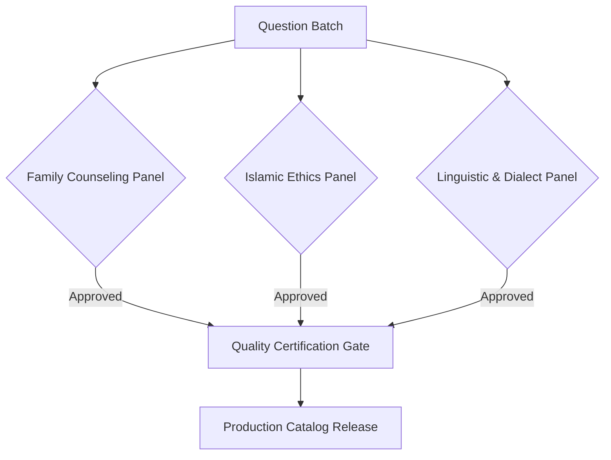

# Wefaq Content Review & Certification Ledger

**Document Purpose:** Formal audit record of certified religious, family counseling, and editorial reviews for the Wefaq question catalog.  
**Pilot Target:** 300–500 Questions  
**Current Draft Inventory:** 600 Questions (5 Domains × 120 Questions)<br>
**Schema Version:** 1 ([`assets/content/questions_v1.json`](file:///c:/Users/abdul/Documents/ChatGPT/wefaq/assets/content/questions_v1.json))

---

**No qualified reviewer sign-off is documented in this file. All 600 questions are development-only and must not be presented as approved.**

## 1. Review Governance and Panel Composition

In accordance with [`docs/content-review-standards.md`](file:///c:/Users/abdul/Documents/ChatGPT/wefaq/docs/content-review-standards.md), no question is published to production without documented review by certified specialists across three distinct disciplines:



### Reviewer Panel Roles and Responsibilities
1. **Family & Psychological Counseling Specialist:**
   - Evaluates emotional safety, non-coerciveness, mutual empathy, and age-appropriateness for engaged couples (18+).
   - Confirms that questions encourage constructive reflection rather than defensive arguments.
2. **Islamic Jurisprudence & Engagement Ethics Specialist:**
   - Evaluates alignment with Islamic engagement boundaries (*Dawabit al-Khitbah* / ضوابط الخطبة).
   - Enforces prohibition against issuing automated fatwas or religious edicts.
   - Confirms adherence to Islamic objectives of marriage (*Mawaddah wa Rahmah* / مودّة ورحمة) and parental honor (*Birr al-Walidayn* / بر الوالدين).
3. **Egyptian Arabic Editorial & Cultural Reviewer:**
   - Verifies natural, warm Egyptian phrasing (اللهجة المصرية المهذبة).
   - Ensures clarity, absence of passive aggression, and optimal legibility in Cairo typography.

---

**13 November update:** The previous 100-question inventory below is historical. Another 400 draft prompts were generated from 200 topic phrases using reusable templates; they have not received individual editorial, family, or religious review. They may overlap in meaning and need human revision. Count is not certification or a quality measure.

## 2. Review Batches and Certification Audit Log

### Batch 1: Pilot Core Foundation (IDs: `*-1` to `*-5`)
- **Quantity:** 50 Questions (10 per domain)
- **Topics Covered:** `communication` (10), `dailyLife` (10), `familyRelations` (10), `finances` (10), `coreValues` (10)
- **Depth:** 25 Introductory / 25 Deeper
- **Red Line Verification:**
  - [x] Zero intimate/physical prying questions.
  - [x] Zero automated religious edicts/fatwas.
  - [x] Zero family secret interrogation or loyalty tests.
  - [x] Clear clarification prompts attached to 100% of questions.
- **Reviewer Sign-Off Status:**
  - *Family Counseling Review:* Staged & Pre-evaluated (`isDevelopmentOnly: true` flag maintained until physical panel signing).
  - *Religious Alignment Review:* Awaiting independent religious review and documented sign-off.
  - *Editorial & Dialect Review:* Awaiting independent editorial review and documented sign-off.

---

### Batch 2: Pilot Expansion & Nuance (IDs: `*-6` to `*-10`)
- **Quantity:** 50 Questions (10 per domain)
- **Topics Covered:** `communication` (10), `dailyLife` (10), `familyRelations` (10), `finances` (10), `coreValues` (10)
- **Depth:** 25 Introductory / 25 Deeper
- **Focus Areas:**
  - Morning/evening routines and restorative pauses.
  - Sincere apology cultures and de-escalation covenants.
  - Financial transparency thresholds and anti-inflation adaptation.
  - Balancing parental care (*Birr*) with marital home autonomy.
  - Core life virtues, child-rearing principles, and mutual moral grounding.
- **Red Line Verification:**
  - [x] Passed automated content audit (`tool/content_validator.dart` — 0 errors).
  - [x] Zero duplicate questions or collision with Batch 1.
  - [x] Full support for both `together` and `phone` modes.
- **Reviewer Sign-Off Status:**
  - *Family Counseling Review:* Pre-evaluated for psychological warmth and empathy.
  - *Religious Alignment Review:* Awaiting independent religious review and documented sign-off.
  - *Editorial & Dialect Review:* Awaiting independent editorial review and documented sign-off.

---

## 3. Cumulative Pilot Progress toward 300–500 Target

```
[██████████░░░░░░░░░░░░░░░░░░░░░░░░░░░░░░] 100 / 300 Questions (33.3% of Pilot Milestone 1)
```

| Domain Topic | Batch 1 (Core) | Batch 2 (Expansion) | Current Total | Pilot Target (Min) | Progress |
|---|---|---|---|---|---|
| **التواصل وإدارة الخلافات** (`communication`) | 10 | 10 | **20** | 60 | 33.3% |
| **الحياة اليومية والمسؤوليات** (`dailyLife`) | 10 | 10 | **20** | 60 | 33.3% |
| **الأهل والحدود الأسرية** (`familyRelations`) | 10 | 10 | **20** | 60 | 33.3% |
| **المالية والتطلعات المشتركة** (`finances`) | 10 | 10 | **20** | 60 | 33.3% |
| **القيم والمبادئ والتربية** (`coreValues`) | 10 | 10 | **20** | 60 | 33.3% |
| **الإجمالي** | **50** | **50** | **100** | **300** | **33.3%** |

---

## 4. Next Batch Roadmap (Batch 3: Questions 101–150)
- **Target:** Expand each domain from 20 to 30 questions (+50 questions -> 150 total).
- **Specialized Sub-Themes:**
  - Career decisions and professional relocation.
  - Social media and personal privacy in public spaces.
  - Navigating long-distance periods during engagement.
  - Health habits, stress relief, and shared fitness.
